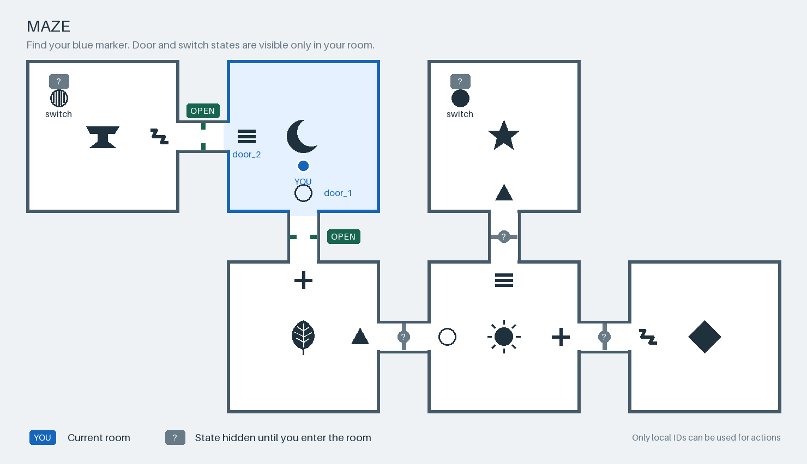

# Cooperative Maze RL

## Goal

Train a text Expert to guide a visual Operator through a maze. Test whether RL improves questioning, navigation and recovery on unseen starts and mazes.

A quick try at building an RL environment with Tinker. The idea was inspired by [GPTNT](https://gptnt.github.io/)!

[What changed and what helped](CHANGELOG.md)

## Components

| Component | Role |
|---|---|
| Environment | Generated six-room mazes, two persistent switches and a goal. A solver verifies solvability. |
| Expert — Qwen3-8B | Trainable text model. Receives the private manual and full conversation, without images. |
| Operator — Qwen3.5-9B | Frozen visual model. Receives current overview/detail images and the last two exchanges. |
| Harness | Routes messages, validates JSON actions, executes them and returns feedback. |

The Expert sends `ask` or `instruct`. The Operator answers or requests `move` or `toggle`. Only validated physical actions change the maze.



[Room detail](docs/maze-detail.png) · [Example manual](docs/manual.txt)

The image shows all rooms and connections, with door/switch states revealed only locally. The private manual supplies destinations, gate rules and the goal.

Difficulty follows the shortest physical solution: **easy 1–3 actions, medium 4–6, hard 7–10**. This excludes communication and perception difficulty.

## Reward

Reach the goal: **1**. Exhaust the episode budget: **0**. Episodes allow up to 32 exchanges and 16 physical attempts. There are no intermediate rewards or efficiency bonuses.

## Training with Tinker

The environment runs locally; Tinker handles sampling and Expert LoRA updates. Only Expert response tokens receive training signal. Manuals, partner replies and feedback remain context.

The current objective is a **simplified GRPO-style update**:

1. Sample eight fresh episodes on the same task, with independent resets.
2. Compute each episode's advantage: reward minus the group's mean reward.
3. Apply one importance-sampling update, refresh the Expert sampler and repeat.

## Run the local demo

```sh
uv sync --locked
.venv/bin/python -m panel_guide.demo
```

Writes images and traces to `outputs/maze-overview-demo/`, without model calls.

Run checks with `.venv/bin/python -m unittest discover -s tests`.

For a paid model episode, copy `.env.example` to `.env`, set `TINKER_API_KEY`, then run:

```sh
uv sync --locked --extra models
.venv/bin/python -m panel_guide.run_episode --backend tinker --task one-switch --budget-usd 1
```

Settings live in [configs/maze.toml](configs/maze.toml). Generate a maze bank with `.venv/bin/python -m panel_guide.generate_mazes --output-dir data/mazes`.

## Current experiment

SFT, RL and inference comparisons have been run. Thinking improved sampled completion; reliable gains from RL remain unestablished. The current local experiment trains the initial Expert with thinking on two easy tasks, using groups of eight and no supervised replay.

The public code contains the environment, rollout interface and tests. Its demo configuration is V7 with thinking disabled. Local research uses V8 with thinking enabled; training scripts and full experiment artifacts are not yet included in the public repository.
