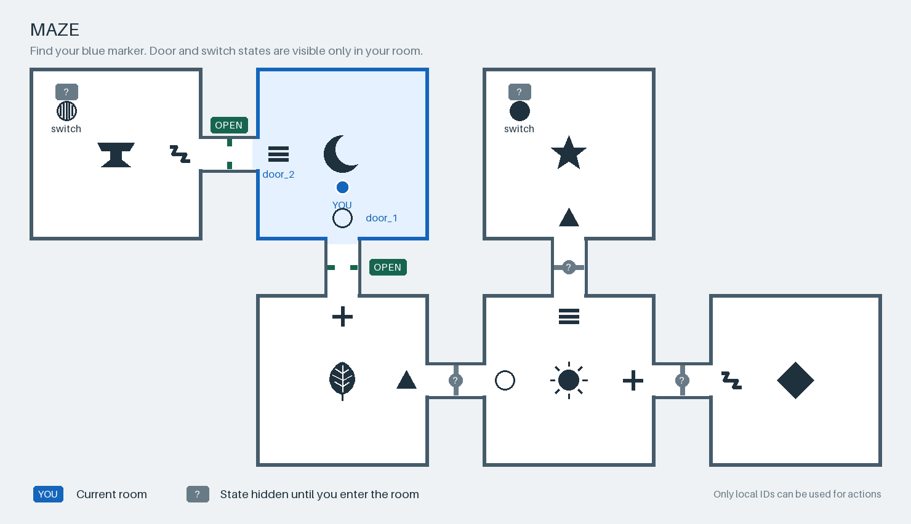

# Cooperative Maze RL

## Goal

Train a text Expert to guide a visual Operator through a maze. Test whether RL improves questioning, navigation and recovery on unseen starts and mazes.

Inspired by [GPTNT](https://gptnt.github.io/).

[What changed and what helped](CHANGELOG.md)

## Components

| Component | Role |
|---|---|
| Environment | Generated six-room mazes, two persistent switches and a goal. A solver verifies solvability. |
| Expert — Qwen3-8B | Trainable text model with thinking. Receives the private manual and full conversation, without images. |
| Operator — Qwen3.5-9B | Frozen visual model. Receives current overview/detail images and the last two exchanges. |
| Harness | Routes messages, validates JSON actions, executes them and returns feedback. |

The Expert sends `ask` or `instruct`. The Operator answers or requests `move` or `toggle`. Only validated physical actions change the maze. An invalid Expert message ends the episode with reward 0. With prompt `v9` (default), the Expert may also keep a short private note; `v8` is the same without notes.



[Room detail](docs/maze-detail.png) · [Example manual](docs/manual.txt)

The image shows all rooms and connections, with door/switch states revealed only locally. The private manual supplies destinations, gate rules and the goal.

Difficulty follows the shortest physical solution: **easy 1–3 actions, medium 4–6, hard 7–10**. This excludes communication and perception difficulty.

## Reward

Reach the goal: **1**. Exhaust the episode budget: **0**. Episodes allow up to 32 exchanges and 16 physical attempts. There are no intermediate rewards or efficiency bonuses.

## Training with Tinker

The environment runs locally; Tinker handles sampling and Expert LoRA updates. Only Expert response tokens receive training signal. Manuals, partner replies and feedback remain context.

The current objective is a **simplified GRPO-style update**:

1. Sample eight fresh episodes on the same task, with independent resets.
2. Compute each episode's advantage: reward minus the group's mean reward.
3. Scale each episode by mean length / its length, so long failures don't outweigh short successes.
4. Apply one importance-sampling update, refresh the Expert sampler and repeat.

By default there is no PPO clipping or reference KL; `steps_per_batch > 1` switches to Tinker's clipped `ppo` loss. The loop is `panel_guide/train_rl.py` (settings under `[training]` in the config), the update math is in `panel_guide/train.py`, and `panel_guide/task_sampler.py` picks tasks likely to give mixed-reward groups. Groups with an interrupted episode are dropped, and the run stops if more than 10% of a batch's episodes end on an invalid Expert message. Two options are off by default: `progress_weight > 0` adds solver-checked per-turn credit (+1 for a step closer to the goal, −1 for a step away) to the episode advantage, and `stop_when_lost = true` ends an episode once the solver proves the goal unreachable (reward 0 either way). Completed model calls release their unused output reservation, so the spending guard tracks token cost rather than the worst case.

`--decisions starts.jsonl` restarts episodes from recorded mid-episode prefixes, so groups focus on chosen decision points.

```sh
.venv/bin/python -m panel_guide.train_rl --bank data/mazes --check            # free: plan and rough cost
.venv/bin/python -m panel_guide.train_rl --bank data/mazes --budget-usd 40    # paid
```

## Run the local demo

```sh
uv sync --locked
.venv/bin/python -m panel_guide.demo
```

Writes images and traces to `outputs/maze-overview-demo/`, without model calls.

Run checks with `.venv/bin/python -m unittest discover -s tests` (Env and training tests need `--extra models`).

For a paid model episode, copy `.env.example` to `.env`, set `TINKER_API_KEY`, then run:

```sh
uv sync --locked --extra models
.venv/bin/python -m panel_guide.run_episode --backend tinker --task one-switch --budget-usd 1
```

Settings live in [configs/maze.toml](configs/maze.toml). Generate a maze bank with `.venv/bin/python -m panel_guide.generate_mazes --output-dir data/mazes`.

## Results so far

Thinking improved completion without training. RL fits the tasks it trains on (4-task pilot: **20/32 → 25/32**) but has not improved unseen tasks (**81 vs 82 of 120**).

Later attempts targeted the Expert's decisions directly: restarts from recorded mid-episode states, solver progress credit, and fine-tuning on solver-checked moves. None cleared its pre-set bar. On 85 held-out restarts, the best result was a first move closer to the goal **36.8% → 38.2%**. The Expert's errors are systematic, and updates so far barely move the policy, even on its own training points.

Results, lessons and next steps: [RL status](docs/rl-status.md). Notes on debugging the pipeline: [LEARNING.md](LEARNING.md).
