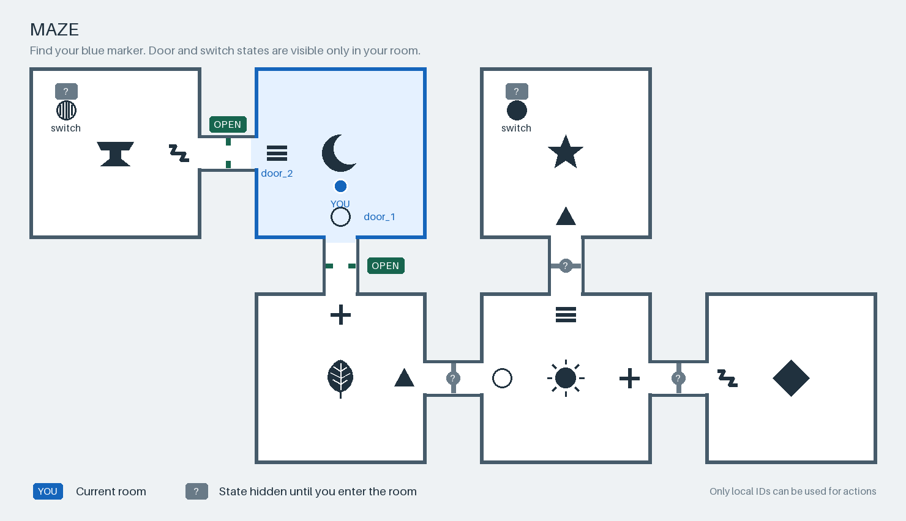

# Cooperative Maze RL

## Goal

Train a text Expert to guide a visual Operator through a maze. Test whether RL improves questioning, navigation and recovery on unseen starts and mazes.

A quick try at building an RL environment with Tinker. The idea was inspired by [GPTNT](https://gptnt.github.io/)!

[What changed and what helped](CHANGELOG.md)

## Components

| Component | Role |
|---|---|
| Environment | Generated six-room mazes, two persistent switches and a goal. A solver verifies solvability. |
| Expert — Qwen3-8B | Trainable text model with thinking. Receives the private manual and full conversation, without images. |
| Operator — Qwen3.5-9B | Frozen visual model. Receives current overview/detail images and the last two exchanges. |
| Harness | Routes messages, validates JSON actions, executes them and returns feedback. |

The Expert sends `ask` or `instruct`. The Operator answers or requests `move` or `toggle`. Only validated physical actions change the maze. An invalid Expert message ends the episode with reward 0. With prompt `v9` (default), the Expert may also keep a short private note; `v8` is the same without notes.



[Room detail](docs/maze-detail.png) · [Example manual](docs/manual.txt)

The image shows all rooms and connections, with door/switch states revealed only locally. The private manual supplies destinations, gate rules and the goal.

Difficulty follows the shortest physical solution: **easy 1–3 actions, medium 4–6, hard 7–10**. This excludes communication and perception difficulty.

## Reward

Reach the goal: **1**. Exhaust the episode budget: **0**. Episodes allow up to 32 exchanges and 16 physical attempts. There are no intermediate rewards or efficiency bonuses.

## Training with Tinker

The environment runs locally; Tinker handles sampling and Expert LoRA updates. Only Expert response tokens receive training signal. Manuals, partner replies and feedback remain context.

The current objective is a **simplified GRPO-style update**:

1. Sample eight fresh episodes on the same task, with independent resets.
2. Compute each episode's advantage: reward minus the group's mean reward.
3. Scale each episode by mean length / its length, so long failures don't outweigh short successes.
4. Apply one importance-sampling update, refresh the Expert sampler and repeat.

There is no PPO clipping or reference KL. Update helpers are in `panel_guide/train.py`; `panel_guide/task_sampler.py` picks training tasks likely to give mixed-reward groups.

## Run the local demo

```sh
uv sync --locked
.venv/bin/python -m panel_guide.demo
```

Writes images and traces to `outputs/maze-overview-demo/`, without model calls.

Run checks with `.venv/bin/python -m unittest discover -s tests` (Env and training tests need `--extra models`).

For a paid model episode, copy `.env.example` to `.env`, set `TINKER_API_KEY`, then run:

```sh
uv sync --locked --extra models
.venv/bin/python -m panel_guide.run_episode --backend tinker --task one-switch --budget-usd 1
```

Settings live in [configs/maze.toml](configs/maze.toml). Generate a maze bank with `.venv/bin/python -m panel_guide.generate_mazes --output-dir data/mazes`.

## Results so far

Thinking improved completion without training. RL fits the tasks it trains on (4-task pilot: **20/32 → 25/32**) but has not improved unseen tasks (**81 vs 82 of 120**). See [RL status](docs/rl-status.md).

This repository contains the environment, rollout interface, update helpers and tests. Training launchers and run artifacts are kept locally.
